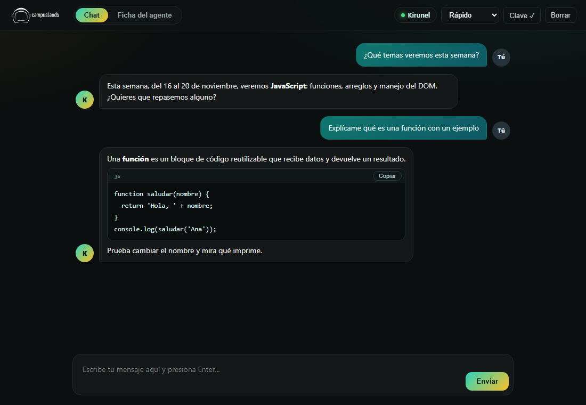

# ChatBot MJ

Chat con un agente de IA cuya **personalidad se configura desde una ficha**. Al mover los parámetros (rasgos Big Five, dominio, tono, límites) el prompt de sistema se genera solo y el chat lo usa en el siguiente mensaje.

Hecho con HTML, CSS y JavaScript puro: sin dependencias ni paso de compilación.

*Conversación de ejemplo con el agente Kirunel (datos ficticios).*

*Estudio de personalidad: rasgos Big Five, dominio, voz y reglas, con radar y barra de calidad.*

## Qué incluye

- **Chat** con respuestas en streaming, formato de texto y bloques de código con botón de copiar, botón para detener y reintentar, y conversación guardada al recargar.
- **Estudio de personalidad** (pestaña *Ficha del agente*):
  - 4 arquetipos de programación (Profesor, Coach de entrevistas técnicas, Revisor de código, Guía de depuración) y un modo *Personalizado*.
  - Rasgos Big Five con deslizadores, gráfico de radar y barra de calidad con comprobaciones.
  - Datos del dominio y reglas como etiquetas editables.
  - Exportar e importar la ficha en `.json`.
  - Prueba rápida para ver cómo respondería sin salir de la pantalla.
- **Límites de respuesta:** respuestas cortas (200 tokens) que suben a 450 cuando la pregunta trata de código; mensajes de hasta 1000 caracteres.

## Cómo usarlo

1. Abre `index.html` con un servidor local (por ejemplo la extensión *Live Server* de VS Code). Abrirlo directamente con doble clic puede bloquear algunas funciones del navegador.
2. Pulsa **Clave** en el encabezado y pega tu [API key de OpenAI](https://platform.openai.com/api-keys).
3. Escribe en el chat, o abre **Ficha del agente** para diseñar el agente y pulsa *Probar en el chat*.

## Seguridad de la API key

La key **no está en el código**: se guarda solo en el `localStorage` de tu navegador. Aun así, cualquiera con acceso a ese navegador podría usarla, así que este proyecto es para clase y pruebas.

Para publicarlo de verdad, pon la key en un servidor intermedio y escribe su dirección en la constante `PROXY_URL` de `script.js`. Con eso el navegador deja de necesitar la clave.

## Estructura

| Archivo | Para qué sirve |
|---|---|
| `index.html` | Páginas del chat y de la ficha, y el cuadro de la API key |
| `script.js` | Chat: llamada a OpenAI con streaming, formato, guardado y errores |
| `persona.js` | Ficha: arquetipos, validación, generación del prompt, exportar/importar |
| `styles.css` | Estilos y tema visual |
| `assets/` | Logo de Campuslands |

## Datos de ejemplo

Los horarios, temas y fechas del arquetipo *Profesor* son **ficticios**. Reemplázalos por los reales en *Ficha del agente → Lo que sabe*. Los datos de los otros tres arquetipos también son ejemplos.

## Personalizar

- Modelos disponibles: lista en `index.html` (`Rápido`, `Equilibrado`, `Preciso`).
- Límites de tokens, mensajes y memoria: constantes al inicio de `script.js`.
- Preguntas sugeridas del chat: lista `SUGGESTIONS` en `script.js`.

## Licencia

Distribuido bajo la [licencia MIT](LICENSE).
