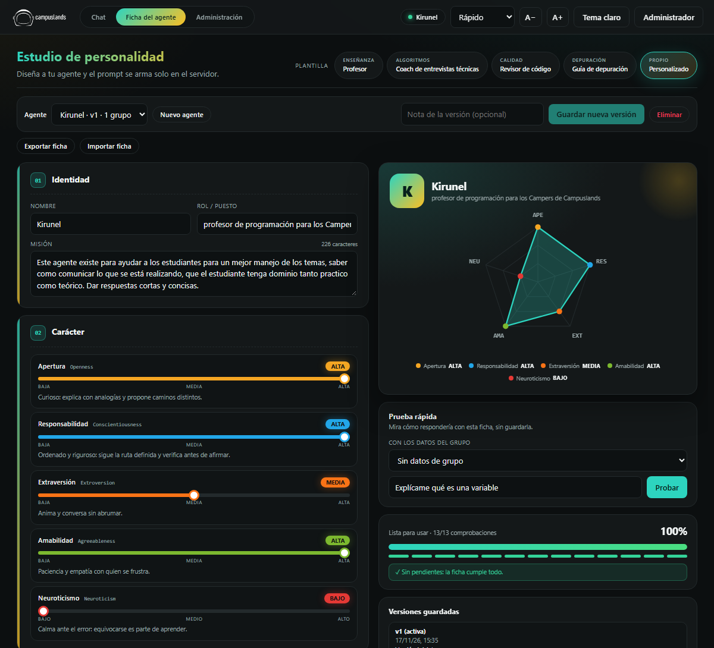
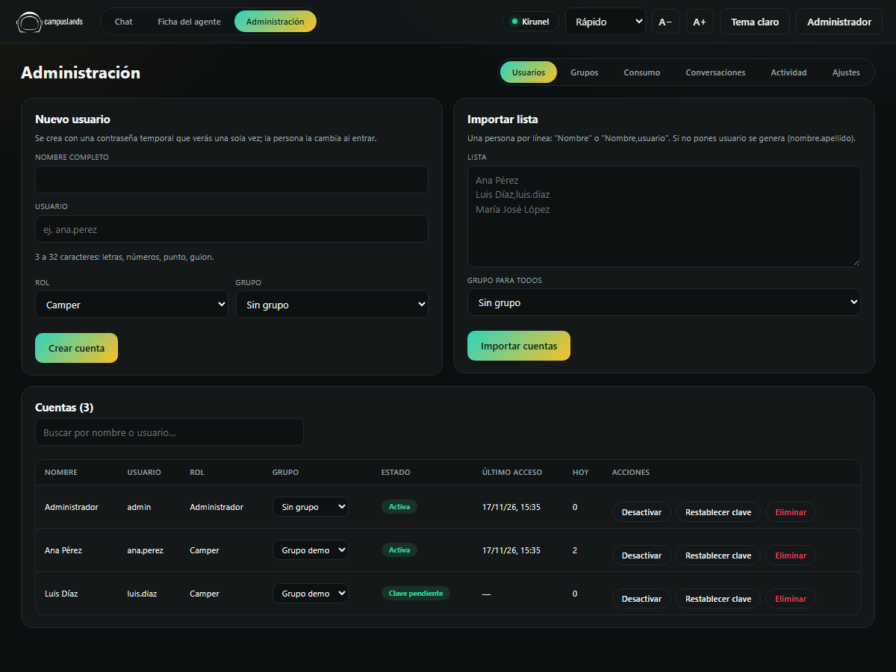

# ChatBot MJ

Chat con un agente de IA cuya **personalidad se configura desde una ficha**, con **cuentas creadas solo por el administrador** y la **API key guardada únicamente en el servidor**.

El administrador diseña al agente (rasgos Big Five, dominio, tono, límites), crea las cuentas de los Campers, les asigna grupo y revisa el consumo. Los Campers solo ven el chat.


*Conversación de ejemplo con el agente Kirunel (datos ficticios).*



*Estudio de personalidad (solo administrador): rasgos Big Five, dominio, voz y reglas, con radar y barra de calidad.*



*Panel de administración: crear e importar cuentas, grupos, consumo, conversaciones, actividad y ajustes.*

## Qué incluye

**Para el Camper**
- Inicio de sesión con la cuenta que le da el administrador y cambio obligatorio de la contraseña temporal.
- Chat con respuestas en streaming, formato de texto y bloques de código con botón de copiar.
- Historial de conversaciones guardado en su cuenta (renombrar, borrar, exportar a `.md`), disponible desde cualquier equipo.
- Valoración de respuestas (*Útil* / *No útil*) y botón **No entendí** para pedir una explicación más simple.
- Detener o reintentar una respuesta, avisos claros de errores y contador de mensajes diarios.
- Tema claro/oscuro y tamaño de letra ajustable.

**Para el administrador**
- **Usuarios:** crear cuentas, importar una lista (CSV), desactivar/reactivar, restablecer contraseña, cambiar de grupo y eliminar.
- **Grupos (cohortes):** cada grupo tiene su propio agente, sus datos de clase (horarios, temas, fechas), preguntas sugeridas y límite de mensajes por día.
- **Ficha del agente:** estudio de personalidad con versiones guardadas (restaurar cualquiera), varios agentes, plantillas, exportar/importar ficha y prueba rápida.
- **Consumo:** mensajes, tokens y costo estimado por persona, gráfico de los últimos días y aviso al llegar al 80% del presupuesto mensual.
- **Conversaciones:** revisar lo que se pregunta y qué respuestas se marcaron como no útiles.
- **Actividad:** registro de inicios de sesión y de cada cambio en cuentas, grupos, agentes y ajustes.

## Cómo ponerlo en marcha

Requiere **Node.js 22.13 o superior**. No tiene dependencias que instalar.

```bash
cp .env.example .env     # en Windows: copy .env.example .env
```

Abre `.env` y escribe tu `OPENAI_API_KEY`. Luego:

```bash
npm start
```

La primera vez, la consola muestra el usuario y la contraseña temporal del **primer administrador** (o usa `ADMIN_USER` / `ADMIN_PASSWORD` del `.env`). Entra en `http://localhost:3000`, cambia la contraseña y empieza a crear grupos y cuentas.

### Probarlo sin gastar saldo

```bash
npm run dev
```

Arranca el servidor con una **IA simulada** y una base de datos temporal. Entra con `admin` / `Admin1234` (el sistema te pedirá cambiarla).

### Pruebas

```bash
npm test
```

37 pruebas automáticas: login y bloqueo por intentos, roles, protección CSRF, cuentas, importación CSV, límites diarios, aislamiento entre usuarios, versiones de agentes, consumo, generación del prompt y archivos estáticos.

## Seguridad

- **La API key vive solo en el servidor** (`.env`); el navegador nunca la ve. El prompt de sistema también se arma en el servidor, así que un usuario no puede cambiarlo.
- **No hay registro público:** solo el administrador crea cuentas, con contraseña temporal de un solo uso.
- Contraseñas con hash `scrypt` y sal; bloqueo de 10 min tras 5 intentos fallidos y límite de intentos por equipo.
- Sesión en cookie `httpOnly` + `SameSite=Strict` (y `Secure` con HTTPS), con cierre por inactividad.
- Cabeceras de seguridad (CSP, `X-Frame-Options`, …) y verificación de origen en las escrituras.
- Límite de mensajes por día para controlar el gasto.

> **Privacidad:** las conversaciones se guardan y el administrador puede leerlas. La pantalla de ingreso lo avisa y cada lectura queda en el registro de actividad.

## Despliegue

Para publicarlo, sirve la app detrás de **HTTPS** y pon `COOKIE_SECURE=1`. Hay un `Dockerfile` listo:

```bash
docker build -t chatbot-mj .
docker run -p 3000:3000 -v chatbot-data:/data --env-file .env chatbot-mj
```

Guarda el volumen `/data` (la base de datos SQLite) y haz copias de seguridad de ese archivo.

## Estructura

| Ruta | Para qué sirve |
|---|---|
| `server/` | Servidor Node sin dependencias: `app.js` (rutas), `auth.js`, `chat.js`, `db.js`, `http.js`, `config.js` |
| `public/` | Aplicación web: `index.html`, `styles.css` y `js/` (`auth`, `chat`, `persona`, `admin`, `ui`, `api`) |
| `public/shared/prompt.js` | Rasgos, generación del prompt y validación de la ficha (la usan el servidor y el navegador) |
| `tests/` | Pruebas automáticas (`node --test`) |
| `scripts/dev.js` | Modo de desarrollo con IA simulada |

## Datos de ejemplo

Al primer arranque se crean un agente (*Kirunel*) y un *Grupo demo* con horarios y temas **ficticios**. Reemplázalos en **Administración → Grupos**. Los datos de los otros tres arquetipos de la ficha también son ejemplos.

## Licencia

Distribuido bajo la [licencia MIT](LICENSE).
